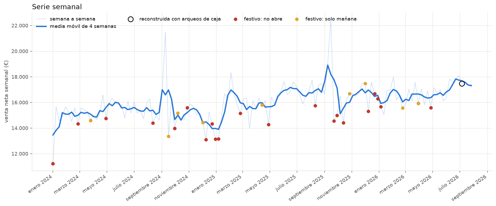
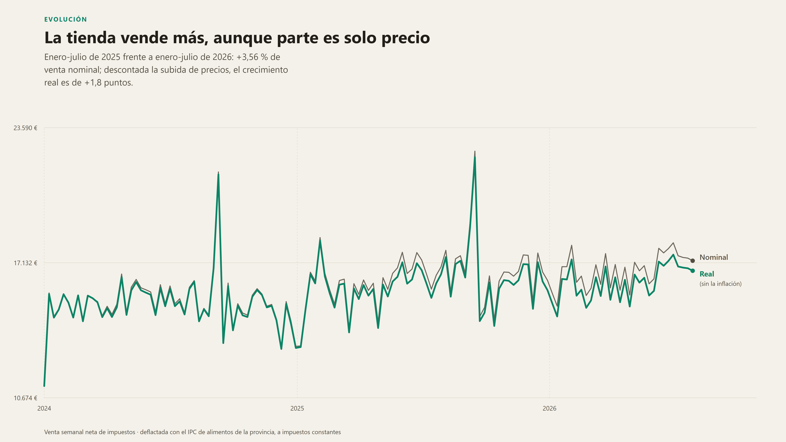
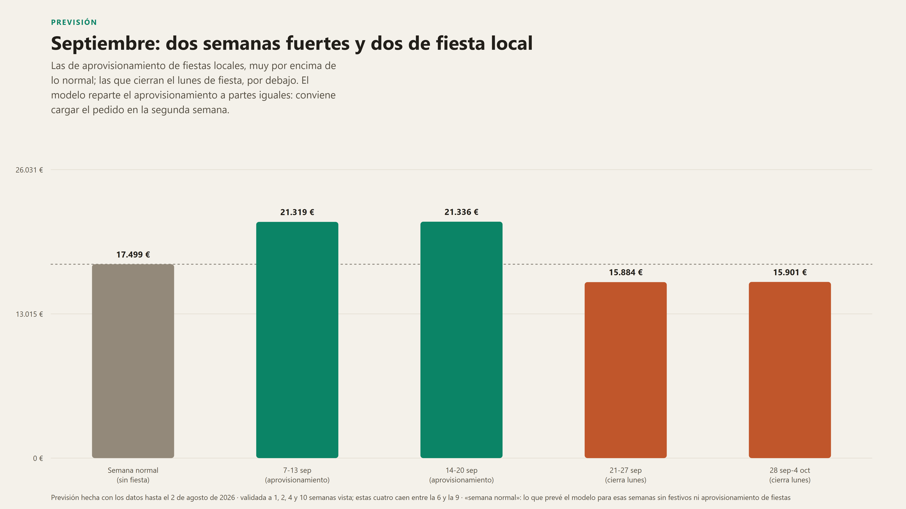
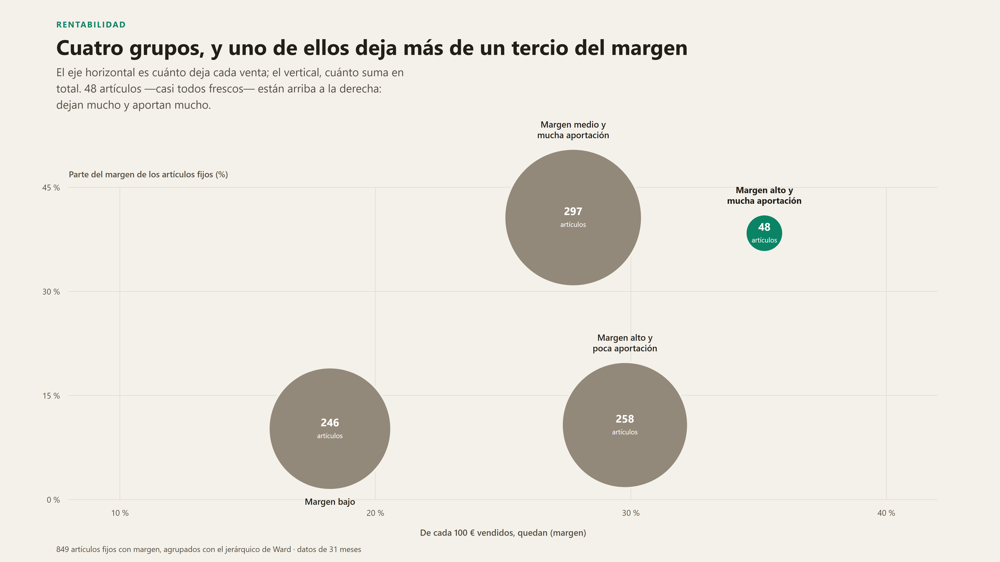

# Ciencia de datos para el pequeño comercio

**Previsión de ventas y rentabilidad con datos reales de un supermercado de proximidad**

Trabajo Fin de Máster · Máster en Data Science y Big Data · Universidad de Sevilla (2026)
María Lourdes Martín García · Tutor: David Gálvez Ruiz

¡Hola! Mi nombre es Lourdes y tengo formación en Economía y en Data Science.
Estos son los resultados de mi TFM, llamado «Ciencia de datos para el pequeño
comercio». He estudiado las ventas que ha tenido una tienda familiar de barrio
desde enero de 2024 hasta agosto de 2026 gracias al programa de caja. Me
sorprendió descubrir que el programa perdió las ventas de dos días sin que el
sistema diera ningún aviso. Aprendí que lo más importante es entender en qué se
basa el modelo de negocio.

`Python` · `pandas` · `statsmodels` · `scikit-learn` · `R` · series temporales · regresión logística · análisis de supervivencia · *clustering*

> **🇬🇧 English summary.** Master's thesis in Data Science (University of
> Seville) built on **real sales data from a small family-run supermarket**:
> 135 weeks of till reports and 31 months of item-level sales, parsed from the
> store's point-of-sale PDFs and CSVs.
> - **Weekly sales forecast:** a linear regression on five calendar terms beat
>   13 alternatives (exponential smoothing, Holt-Winters, ARIMA with regressors)
>   in a **76-fold rolling-origin validation**, with a median error of **€642
>   per week (4 % of sales)** four weeks ahead.
> - **Data quality finding:** cross-checking against photos of the till
>   receipts revealed that the POS platform had silently **lost 506 sales
>   documents (€5,751.82)**; the week was rebuilt and a ticket-numbering check
>   now catches such gaps.
> - **Real growth vs. inflation:** sales grew 3.56 % nominal but only 1.80
>   points in real terms (CPI-deflated at constant tax rates), all of it from
>   more customers, not bigger baskets.
> - **Product analytics:** Ward hierarchical clustering of the catalogue by
>   profitability (checked against k-means and Gaussian mixtures), and a
>   logistic regression plus a survival tree to flag new products unlikely to
>   stay on the shelf (AUC 0.705; of the lowest-scored, only 4.6 % survive).
>
> The business is anonymised; raw store data is not included. Notebooks and
> report are in Spanish.

---

## La pregunta de negocio

Una empresa familiar gestiona un supermercado Covirán en un municipio de
Almería. Su programa de gestión guarda cada venta, pero las gerentes
no tenían ninguna serie histórica ni ninguna previsión. El trabajo responde a
tres preguntas:

1. **¿Cuánto se venderá en las próximas semanas?** Para ajustar los pedidos.
2. **¿Qué artículos sostienen el margen?** Para saber cuáles cuidar y cuáles revisar.
3. **¿Seguirá vendiéndose un artículo nuevo?** Para decidir qué no reponer.

## Los datos

| Fuente | Qué es | Volumen |
|---|---|---|
| Cierres Z semanales | Informes PDF de cierre de caja del programa de gestión | 135 semanas, ene. 2024 → ago. 2026 |
| Diario de ventas por artículo | Informes CSV mensuales | 31 meses, 6.696 artículos, 91.731 filas |
| IPC del INE | Índice de alimentos de Almería, para deflactar | Público |
| Calendario de festivos | Reconstruido con la tienda: qué festivos abre y con qué horario | 2024-2026 |
| Arqueos de caja | Transcritos de las fotos que la caja imprime en cada turno | 4 cierres, 8 y 9 de julio de 2026 |

Los informes del programa están pensados para leerse, no para analizarse, así
que el primer trabajo fue escribir dos programas de lectura que los convierten
en tablas y **validan cada informe contra su propio total**.



## El hallazgo que no estaba en el plan: el programa perdía ventas

Una semana de julio de 2026 parecía tener dos días cerrados. Al contrastarla
con las fotos del arqueo que imprime la caja en cada turno —la única fuente
independiente del programa—, resultó que la tienda **sí abrió**: el programa
había perdido **506 documentos de venta (5.751,82 €)** sin ninguna señal en sus
informes. La venta se reconstruyó con las fotos, y desde entonces la carga
comprueba la numeración de los tickets.

## Resultados

**La tienda crece por afluencia, no por gasto.** De enero-julio de 2025 a
enero-julio de 2026 la venta nominal sube un 3,56 %, pero descontando la subida
de precios a impuestos constantes el crecimiento real es de 1,80 puntos. Los
tickets suben un 15,9 % y el ticket medio real cae un 4,9 %.



**1 · Previsión de la venta semanal.** Una regresión lineal con cinco
términos de calendario —la constante, la tendencia, las horas de cierre en
festivo, la Semana Santa y las dos semanas de aprovisionamiento antes de las
fiestas locales— gana a otros trece modelos, entre ellos
ARIMA, Holt-Winters y alisado exponencial. Se validó con **origen móvil en 76
particiones**: se equivoca en una mediana de **642 € por semana, el 4 % de la
venta**, a cuatro semanas vista (R² = 0,678). En septiembre de 2026, fuera de la
ventana de estudio, 3 de las 4 semanas reales cayeron dentro del intervalo de
predicción.



**2 · Qué artículos sostienen el margen.** El margen sobre la mercancía es del
28,38 %, calculado sobre la tarifa de coste: la columna de coste medio del
programa se descartó por no ser fiable, comprobado con una ficha de coste real
que facilitó la tienda. Una agrupación jerárquica de Ward divide el surtido
permanente en cuatro grupos; 48 artículos, casi todos frescos, aportan el 38,4 %
del margen. Contrastada con *k*-means y mixturas gaussianas.



**3 · Qué artículos nuevos se quedan.** Una regresión logística (AUC 0,705)
sobre los 1.302 artículos estrenados, completada con Kaplan-Meier y un árbol de
supervivencia, funciona como filtro: de los peor puntuados solo sigue en el
lineal el 4,6 %.

## Los documentos, según quién los lea

| Documento | Para quién | Qué contiene |
|---|---|---|
| 📄 **[Resultados para la tienda](documentos/resultados_para_la_tienda.pdf)** (5 págs.) | Quien gestiona el negocio | Lo que se encontró y lo que se puede hacer con ello, sin teoría: el informe que recibieron las gerentes |
| 📊 [Presentación](documentos/presentacion_defensa.pdf) (16 diapositivas) | Lectura rápida | Las cifras clave de los tres estudios y las recomendaciones |
| 📘 [Memoria completa](documentos/memoria_tfm.pdf) (62 págs.) | Perfil técnico | Metodología, validación, decisiones y anomalías de los datos |

## Qué aprendí

- **Los datos reales llegan rotos, y comprobarlos es parte del análisis.** Los
  informes cuadraban consigo mismos y aun así les faltaban ventas; solo
  contrastarlos con una fuente independiente lo destapó.
- **Validar bien importa más que el modelo.** Con pocos datos, un único corte
  entre entrenamiento y prueba engaña; la validación de origen móvil dio una
  comparación fiable, y el modelo más sencillo resultó el mejor.
- **Un resultado vale lo que se entiende.** Elegí modelos interpretables para
  poder explicar a la tienda, en euros, qué mueve sus ventas, y escribí un
  informe aparte, sin teoría, para quien tiene que decidir.
- **El conocimiento del negocio cambia las conclusiones.** Las preguntas a las
  gerentes —horarios de festivos, cómo retiran un artículo, qué significa cada
  columna de coste— corrigieron más de un resultado.

## Reproducibilidad

- Las cifras clave de la memoria se recalculan desde los datos limpios con
  [`src/comprobar_cifras.py`](src/comprobar_cifras.py), que falla si alguna
  deja de cuadrar.
- Semilla fija en todo lo que tiene componente aleatoria.
- Entorno congelado en [`requirements.txt`](requirements.txt) (Python 3.12).

## Estructura

```
src/             Programas de lectura de informes, variables de calendario,
                 modelos, validación, supervivencia y agrupación
notebooks/       01 exploración · 02 surtido · 03 modelado de la serie semanal
                 04 supervivencia de artículos · 05 agrupación del catálogo
reports/figuras/ Figuras que generan los notebooks
datos_externos/  IPC, festivos, folletos de Covirán y arqueos de caja transcritos
documentos/      Resultados para la tienda, presentación y memoria completa, en PDF
```

## Qué no incluye este repositorio

El negocio se presenta **anonimizado**: no se nombran la empresa, la tienda ni
el municipio. Los **informes originales del programa de gestión no se
publican**, así que el código no se puede ejecutar de principio a fin sin
ellos; los notebooks se conservan con sus resultados para poder leerlos. Los
documentos de trabajo internos tampoco se publican; su contenido esencial
—registro de decisiones y de anomalías de los datos— está en los apéndices C y
D de la [memoria](documentos/memoria_tfm.pdf). El informe para la tienda se
publica sin su anexo, que era la lista completa de artículos de cada grupo.

## Licencia

El código se publica con [licencia MIT](LICENSE). Los documentos de
`documentos/` son de la autora y se incluyen para consulta.

## Contacto

[LinkedIn](https://www.linkedin.com/in/marialourdesmartingarcia) · [GitHub](https://github.com/mlouu)
